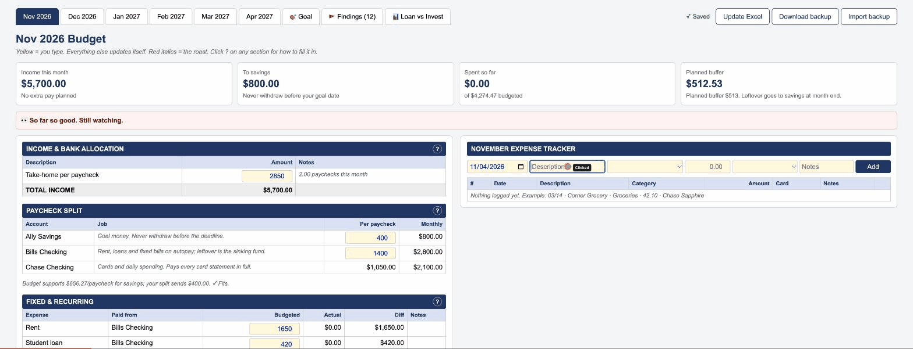
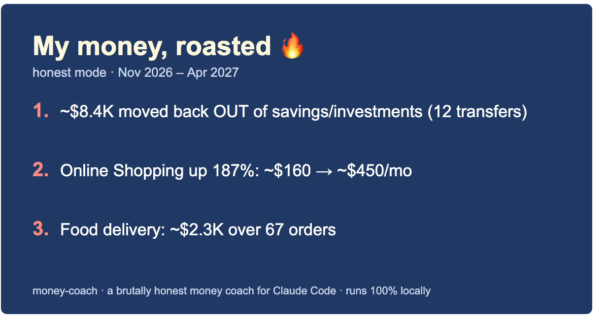
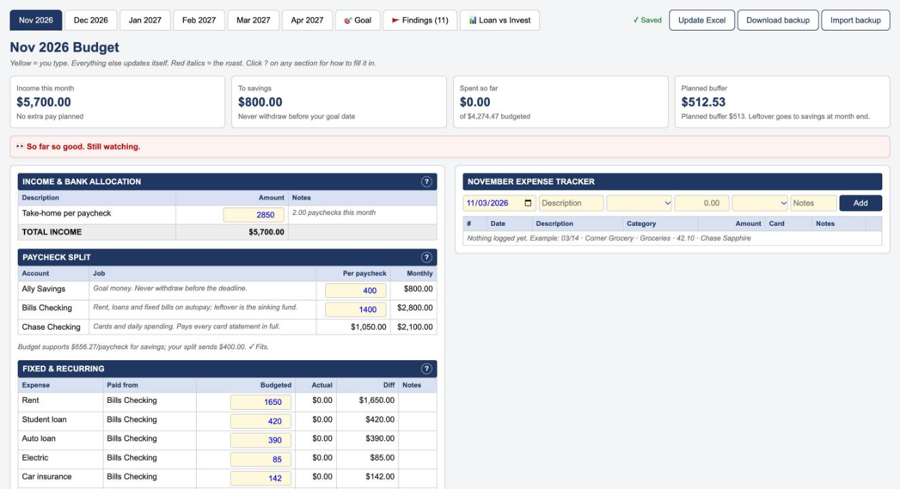
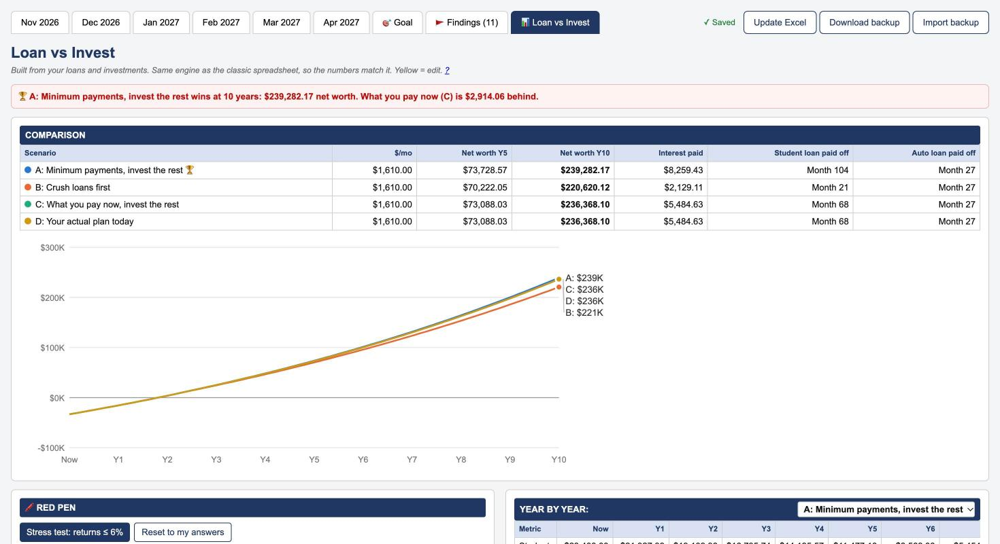

# money-coach 💸

**A brutally honest money coach for Claude Code.** Drop in your bank CSVs and money-coach will:
- audit a year of spending, with one subagent per job
- onboard you right in the CLI
- build a **local budget dashboard + Excel workbook** with a paycheck split planner, a savings-goal tracker, findings ranked by dollars at stake, and a **loan-vs-invest** simulator

It roasts your Amazon habit with your own numbers. It never sees your passwords, and your data never leaves your machine.



## Try it in 10 seconds (fictional data, no AI calls)

```sh
git clone https://github.com/abhinavprkash/money-coach && cd money-coach
python3 scripts/demo.py --open
```

Or, once the plugin is installed: `/money-review demo`. Jordan Demo is made up, but the leaks are real ones: a savings split swept back to checking every month, Amazon twice a week, a "cancelled" Hulu still billing.

## Share your roast 🔥

The Findings tab turns your top 3 roasts into an image you can post. It's made in your browser, nothing is uploaded, and amounts are rounded or hidden.



| Monthly budget + tracker | Loan vs Invest, with a red pen |
|---|---|
|  |  |

## Install

In Claude Code:

```
/plugin marketplace add abhinavprkash/money-coach
/plugin install money-coach@money-coach
```

Requires Python 3.9+ (with `openpyxl` for the Excel workbook) and Node, which Claude Code already uses.

## Use

```
/money-review                    # full review: ingest → audit → onboarding → plan → goal → loans → dashboard
/money-review demo               # same experience on fictional data
/money-review onboard loans      # redo one onboarding section (income, split, bills, subscriptions, priorities, goal, loans, investments, taxes, tone)
/money-dashboard                 # open the local dashboard (http://localhost:8765)
/loan-vs-invest                  # just the "pay off loans or invest?" question
```

1. **Export ~12 months of CSVs** from each bank and card (Chase, Amex, Capital One, Discover, BofA, Wells Fargo, Apple Card and Citi are recognized; anything else is auto-detected) into a `statements/` folder.
2. Run `/money-review` in that folder. If you have the **Cashflow MCP** connected, it can read from that instead (read-only).
3. **First run = onboarding**, in the CLI. Each section has its own guide in [`docs/onboarding/`](docs/onboarding):

| Section | What it asks |
|---|---|
| [Income](docs/onboarding/income.md) | pay frequency, take-home, raises, bonus/PTO/refund |
| [Paycheck split](docs/onboarding/bank-split.md) | which accounts get pay: savings / bills / spending |
| [Fixed bills](docs/onboarding/fixed-bills.md) | confirms detected rent, loans, insurance, utilities |
| [Subscriptions](docs/onboarding/subscriptions.md) | keep / cancel / unsure for every detected one |
| [Spending priorities](docs/onboarding/spending-priorities.md) | what to **protect** and what you're **willing to cut**; this sets the caps and the roasts |
| [Savings goal](docs/onboarding/savings-goal.md) | target, deadline, balances, what counts |
| [Loans](docs/onboarding/loans.md) | **what kinds of loans you have**; Loan vs Invest is built from these |
| [Investments](docs/onboarding/investments.md) | funds, weights, honest return assumptions |
| [Taxes](docs/onboarding/taxes.md) | your marginal rates (entered by you, never assumed) |
| [Cards & tone](docs/onboarding/cards-and-tone.md) | card names, and gentle / honest / savage |

Nothing personal is hardcoded. Every number comes from your answers or your own transactions. If something required is missing, the build stops and tells you which onboarding section to redo.

## How it works: one subagent per job

| Agent | Writes |
|---|---|
| `data-ingest` | `transactions.csv` (normalized, categorized) |
| `ledger-auditor` | `findings/audit.json`: transfers with no other side, savings swept back out, duplicates, P2P |
| `recurring-analyst` | `findings/recurring.json`: subscriptions, price hikes, "cancelled but still charging" |
| `spending-critic` | `findings/spending.json`: equal-window trends and roast lines |
| `budget-planner` | category caps + a paycheck split the budget can actually support |
| `goal-planner` | `findings/goal.json`: month-end checkpoints, levers, windfalls |
| `loan-vs-invest-analyst` | `findings/lvi.json`: scenarios, stress test, red pen |
| `dashboard-builder` | `site/index.html` + `output/Budget.xlsx`, verified |

Independent agents run in parallel. The orchestrator skill (`/money-review`) does all the talking, because subagents can't ask you questions.

## Permissions

The subagents run the plugin's own Python and Node scripts. To avoid a prompt for every step, allow them once in `/permissions` (or `.claude/settings.json`):

```json
{ "permissions": { "allow": ["Bash(python3:*)", "Bash(node:*)"] } }
```

Narrow these to the plugin's install path if you prefer. Nothing the scripts do needs network access.

## Your data

Everything lives in `./money-coach-data/` in the folder you ran it from (permissions `600`):

```
transactions.csv  config.json  analysis.json  findings/*.json
expenses.csv  settings.json  backups/  site/index.html  output/Budget.xlsx
```

The dashboard server listens on `127.0.0.1` only and refuses requests from other sites. Every edit saves to `expenses.csv` / `settings.json`, with a daily backup. **Update Excel** rebuilds the workbook from those same files, so the site and the spreadsheet always match. See [PRIVACY.md](PRIVACY.md).

## Develop

```sh
python3 -m pytest -q              # ingest profiles, analysis, budget math, goal, build, server security
node tests/lvi_engine.test.js     # Loan vs Invest engine vs a reference spreadsheet (to the cent)
python3 scripts/prepublish_check.py   # tests + user-data + private-term scan before any push
```

The Loan vs Invest engine reproduces the classic loan-vs-invest spreadsheet's month-by-month formulas exactly. `tests/lvi_reference_workbook.py` rebuilds that spreadsheet with fictional inputs, and the JS engine must match it to the cent.

## Not financial advice

money-coach does arithmetic on **your** numbers and **your** assumptions. It doesn't know tax law, can't predict markets, and never moves money. Check big decisions with a professional.

MIT © abhinavprkash
